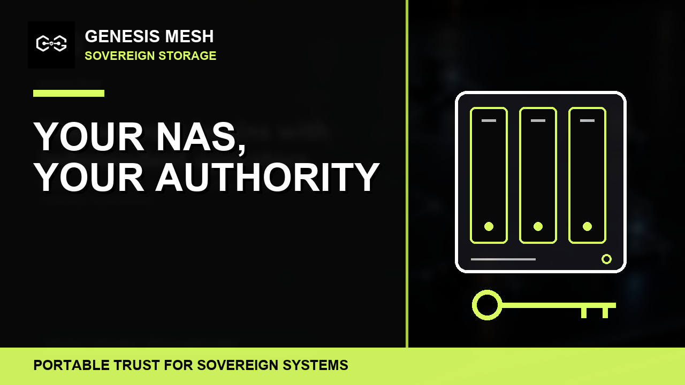

# Your NAS, Your Authority

*Bringing sovereign trust to self-hosting.*

A photographer keeps years of work on a NAS at home. A collaborator needs access to one project. A backup job needs to write to another location. An AI assistant needs to read a selected dataset. Giving all three the same account would be convenient, until one credential is copied, one device is lost, or the collaboration ends.

Owning the disks is only part of owning your data. You also need to control who can reach a service, what they may do, and how that permission ends.

That is the NAS use case I want to explore with Genesis Mesh: bringing operator-owned identity, policy and revocation to the services around personal storage.

## A connection is the beginning

Remote access starts with a connectivity decision. You need a path from the remote device to the service, and that path needs appropriate encryption and exposure controls. A private network can provide that path. It does not, by itself, answer whether a collaborator may read a particular archive or whether an automated process may delete a backup.

Genesis Mesh adds a trust model that an application can use to answer those questions. The operator controls a Network Authority, its keys, membership and policy. Signed attestations describe the identities the authority admits and the claims it gives them. A boundary policy constrains the requests made under that authority.

The application serving the data must enforce the result. Installing an authority beside a NAS does not automatically protect its shares, dashboard or media services.

## One archive, several kinds of access

Consider a small studio sharing a project archive with an outside editor.

The studio could issue an attestation permitting a read capability and naming the project collections the editor may use. A policy could require the requested collection to appear in that signed claim and restrict access to an agreed time window. An upload process could hold a separate capability. A local indexing agent could receive access to a selected dataset without receiving permission to delete it.

These are proposed application capabilities, not file operations Genesis Mesh already ships. A NAS-facing service would map each capability and collection identifier to a real operation and storage location, retain the NAS's own filesystem permissions, and authenticate the caller before asking for a decision. It must also prevent a caller from using a different path to bypass the check.

For a request evaluated under policy, the authority returns a signed decision that identifies the policy versions and gate outcomes behind it. With the signed policies and authority keys, a verifier can check that binding later. This records the authorization basis. Evidence of what the storage service actually did is a separate record.

The useful distinction is between access granted to a person, access granted to a device, and access granted to an automated task. Each can have a different scope and lifecycle instead of sharing one long-lived password.

## What happens when trust ends?

Suppose the editor's laptop is lost. The operator needs a clear way to withdraw its authority and make the storage service stop accepting it.

Genesis Mesh provides signed revocation material and checks for revoked credentials. An integration must keep that state fresh and define how it treats existing sessions and decisions issued before the revocation. Those decisions have a validity window; the five-minute default is not a promise that every open file transfer ends immediately.

The deployment also needs a policy for losing contact with the authority. Does the service refuse new requests? How old may its revocation state become? Who can recover access without quietly disabling the checks?

Revocation prevents further authorized use when the relevant checks enforce it. It cannot retrieve files someone has already downloaded. That boundary matters as much for a home archive as it does for an enterprise data service.

## Who should try this first?

Homelab builders who are comfortable integrating services are a good first audience. They can start with a small application in front of a test dataset and inspect every trust decision.

Creators and small studios have a concrete reason to care: collaborators come and go, while project archives remain. A narrowly scoped sharing service is a more useful first experiment than trying to replace every NAS access method at once.

Developers running agents against local data have a similar problem. An agent may need a dataset, but it does not necessarily need the storage administrator's authority.

Households could benefit from the same separation of access. A simple family experience, however, needs device enrollment, recovery and application integration that people can use without becoming protocol developers. That is product work still to be demonstrated.

## Start with the storage you already operate

The host could be a dedicated NAS appliance, a repurposed PC, or a home server with an application dashboard. That choice affects packaging and deployment. The access model still needs the same pieces: authenticated callers, explicit permissions, an enforcement point, current revocation state and a recovery procedure.

This article does not announce a supported NAS package. The first proof should choose one host and one storage service, document the exact setup, and show both successful access and refusal. Native integrations with particular NAS platforms need their own validation.

## A small proof worth building

The first experiment should expose one read operation over a test dataset through a service that checks Genesis Mesh decisions. It should demonstrate an allowed request, a request for a collection outside the caller's claim, a revoked identity, and stale or unavailable trust state. It should also show what happens to an existing session when authority is withdrawn.

Connectivity needs to be documented separately: which endpoints are reachable, how traffic travels, and whether a relay or another private-network component is involved. The current core provides authenticated mesh messaging, not a ready-made tunnel for arbitrary NAS applications. Neither zero public ports nor maximum-speed direct transfers follows from adding Genesis Mesh.

Those are the questions a future setup guide must answer with a reproducible deployment. The core trust and policy primitives exist today; the NAS integration described here is a design to build and test.

For self-hosting, the opportunity is practical: keep the storage, the keys and the authority to grant or withdraw access under your own control. Start with one service, give each participant only the access it needs, and make the decision something you can inspect.
